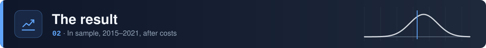
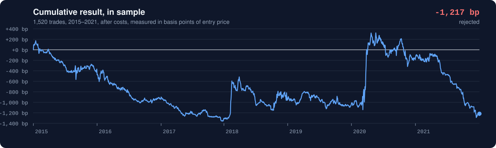

<picture>
  <source media="(prefers-color-scheme: dark)" srcset="./assets/banner-dark.svg" />
  <source media="(prefers-color-scheme: light)" srcset="./assets/banner-light.svg" />
  
</picture>

<br>

<div align="center">
  
  
  
  
  
</div>

<br>

One hypothesis from [the NQ Lab book](https://github.com/nqedgelab/nq-research), tested on its own terms: rules fixed before the test, costs included, and a verdict whichever way it went.

> [!IMPORTANT]
> **Rejected.** The first half hour didn't predict the last half hour on NQ, before costs (+0.34 bp) or after (−0.80 bp). The validation and holdout years were never used, so they stay clean for the next idea.

<br>

<picture>
  <source media="(prefers-color-scheme: dark)" srcset="./assets/section-claim-dark.svg" />
  <source media="(prefers-color-scheme: light)" srcset="./assets/section-claim-light.svg" />
  
</picture>

**Claim.** The return from the previous 16:00 ET close to 10:00 ET predicts the direction of the 15:30–16:00 ET move. Trading the last half hour in that direction has positive expectancy after costs and beats simply buying it every day.

The idea isn't ours. It was published for SPY by Gao, Han, Li and Zhou ("Market Intraday Momentum", *Journal of Financial Economics*, 2018), which makes this an out-of-sample test of someone else's claim on a different instrument.

<div align="center">

| Rule | Setting |
|:---|:---|
| Signal | Previous session's last regular-hours close to the 09:59 bar's close |
| Direction | Long if that return is positive, short if negative, no trade if zero |
| Entry | Open of the 15:30 bar |
| Exit | Close of the 15:59 bar. No stop, no target. |
| Skipped days | Missing bars, early closes, contract-roll weeks, or a previous session more than 4 days back |
| Costs | 0.25 pt commission, 1 tick slippage in and 1 out: 0.75 pt a round trip |
| Benchmark | Always long, same days, same costs |

</div>

There's no stop, so results are in **basis points of the entry price** rather than R. That keeps 2015, when NQ was near 4,000, on equal terms with 2021, when it was over 16,000.

The full write-up, including the case against the idea, is in [`hypothesis.md`](hypothesis.md). It was committed before any test, and that commit is the first one in this repo's history.

<br>

<picture>
  <source media="(prefers-color-scheme: dark)" srcset="./assets/section-result-dark.svg" />
  <source media="(prefers-color-scheme: light)" srcset="./assets/section-result-light.svg" />
  
</picture>

<picture>
  <source media="(prefers-color-scheme: dark)" srcset="./assets/equity-dark.svg" />
  <source media="(prefers-color-scheme: light)" srcset="./assets/equity-light.svg" />
  
</picture>

<div align="center">

| Trades | Win rate | Avg win | Avg loss | Expectancy | 95% CI | Before costs | Always long |
|:---:|:---:|:---:|:---:|:---:|:---:|:---:|:---:|
| 1,520 | 47.3% | 19.3 bp | 18.8 bp | **−0.80 bp** | −2.36 to +0.83 | +0.34 bp | −1.98 bp |

</div>

To pass, expectancy needed to be above zero with the low end of its confidence interval above zero too. Neither held. Breakdowns by direction, year, publication date, size of the first move and volatility are in [`results.md`](results.md); none of them sits entirely above zero.

<br>

<picture>
  <source media="(prefers-color-scheme: dark)" srcset="./assets/section-lessons-dark.svg" />
  <source media="(prefers-color-scheme: light)" srcset="./assets/section-lessons-light.svg" />
  
</picture>

- **The signal was noise.** The morning return and the last half hour had a correlation of 0.02. The direction was right on 50.5% of days.
- **Costs matched the whole move.** About 1.1 bp a round trip, three times the +0.34 bp before costs. Short trades on NQ need a bigger effect than that to survive.
- **It wasn't decay.** Before the paper came out (2015–2018) it already lost money, so the effect didn't fade once known. It just wasn't there on NQ in this window.
- **Benchmarks can flatter.** Always-long lost 1.98 bp, so "beating the benchmark" here meant losing less. That's why step 1, beating zero, comes first.
- **The breakdowns are bait.** The biggest first moves did worst (−4.21 bp), which hints at reversal rather than momentum. That idea comes from this data, so any test of it must be a new hypothesis, first tested on the validation years.

<br>

<picture>
  <source media="(prefers-color-scheme: dark)" srcset="./assets/section-data-dark.svg" />
  <source media="(prefers-color-scheme: light)" srcset="./assets/section-data-light.svg" />
  
</picture>

```bash
pip install -r requirements.txt      # installs nqlab v0.1.0 from the book
python -m pytest                     # 10 tests, one per trading rule
python backtest/h002.py in_sample    # needs NQ_DATA_DIR in a .env file
```

Market data is licensed and isn't in the repo, and neither is the trade list derived from it. `nqlab` is pinned to a tagged version, so later changes to the shared loader can't quietly change this result.

<details>
<summary><b>What's in the repo</b></summary>
<br>

```
nq-h002-intraday-momentum/
├── hypothesis.md       the claim, rules and rejection criteria, written first
├── results.md          full results and breakdowns
├── backtest/
│   ├── h002.py         the backtest
│   └── test_h002.py    one test per trading rule
└── assets/             README artwork and the script that draws it
```

</details>

<br>

<p align="center">
  <sub>Part of <a href="https://github.com/nqedgelab/nq-research">the NQ Lab book</a> · paper traded · not financial advice</sub>
</p>


